# Roadmap

Today's question:

> Why did databases evolve into data platforms?

We will move through the main architectural pressures:

- **Operational data**: databases and OLTP
- **Analytical data**: DWHs and OLAP
- **Heterogeneous data**: NoSQL and data lakes
- **Unified analytics**: lakehouses
- **Managed complexity**: governance, metadata, fabric, mesh, and DataOps

# How did we get here?

**Data-Driven Innovation**

- Use of data and _analytics_ to foster new products, processes, and markets
- Drive discovery and execution of innovation, achieving new services with a business value

**Analytics**

- A catch-all term for different business intelligence (BI) and application-related initiatives
  - E.g., analyzing information from a particular domain
  - E.g., applying BI capabilities to a specific content area (e.g., sales, service, supply chain)

**Advanced Analytics**

- (Semi-)Autonomous examination of data to discover deeper insights, make predictions, or generate recommendations (e.g., through data/text mining and machine learning)

**Augmented Analytics**

- Use of technologies such as machine learning and AI to assist with data preparation, insight generation, and insight explanation to augment how people explore and analyze data

[https://www.gartner.com/en/information-technology/glossary](https://www.gartner.com/en/information-technology/glossary)

# How did we get here?

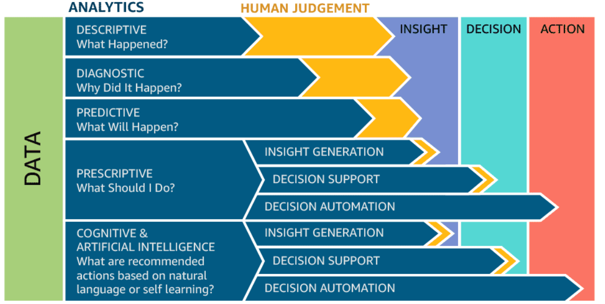

# Data platform: why storage is not enough

Companies are collecting tons of data to enable advanced analytics.

- Raw data is difficult to obtain, interpret, and maintain
- Data is more and more heterogeneous
- There is a need for curating data to make it _consumable_

Where are we _collecting/processing_ data?

- Getting _value_ from data _is not_ (only) a matter of _storage_
- Need integrated and multilevel analytical skills and techniques

# Data platform: value needs context

> "It is a capital mistake to theorize before one has data. Insensibly, one begins to twist the facts to suit theories, instead of theories to suit facts."
>
> - Sherlock Holmes

Getting _value_ from data _is not_ (only) a matter of _storage_. *Examples*?

#  Case study: photo gallery {background-color="#121011"}

 

# End of the case study {background-color="#121011"}

# From databases to data platforms

# Data platform: what is a database?

::::{.columns}
:::{.column width=50%}

> **Database** [@ozsu2018]
>
> "A database is a _structured and persistent collection_ of information about some aspect of the real world, organized and stored in a way that facilitates efficient retrieval and modification. The structure of a database is determined by an _abstract data model_. Primarily, it is this structure that differentiates a database from a data file."

:::
:::{.column width=50%}

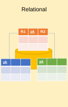

:::
::::

# Data platform: operational data

At the beginning, computer science was seen as a *subsidiary discipline* that makes information management *faster* and *cheaper*

- ... but *did not create (new) profits in itself*

The main goal of databases in companies has been that of storing **operational data** [@DBLP:journals/cacm/Codd70]

- Data generated by operations carried out within business processes

**Online transaction processing (OLTP)** is a type of database system used in transaction-oriented applications, such as many operational systems.

- "Online" refers to the fact that such systems are expected to respond to user requests and process them in real-time.
- Large number of database transactions (writing and reading data) in real-time

# Data platform: decision support

An exponential increase in operational data has made computers the only tools suitable for *decision-making performed by business users*

- The massive use of techniques for analyzing enterprise data made information systems a key factor to achieve business goals

The role of computer science in companies has radically changed since the early 70's.

- ICT systems turned from simple tools to improve process efficiency...
- ... into key factors of company organizations capable of deeply impacting on the structure of business processes

# Problem: how do we manage **data heterogeneity**?

# Data platform: schemaless data

::::{.columns}
:::{.column width=50%}

> **Schemaless databases**
>
> There is no predefined schema that the data must conform to before being added to the database.
> As a result, you don't need to know the structure of your data, enabling you to store all your data more easily and quickly.

:::
:::{.column width=50%}

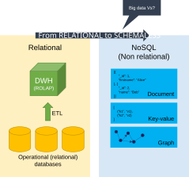

:::
::::

# Problem: how do we transform data into **actionable business insights**?

# Data platform: from big data to small data

**Big Data** must be transformed into **Small Data** so that it can be exploited for decision-making purposes

- *Small* data is data that is *small enough* for human comprehension.
- It is data in a volume and format that makes it accessible, informative and actionable.

# Data platform: analytical scenario

Scenario: 

- Large company, with several branches
- Managers wish to quantify and evaluate the contribution given from each branch to the global profit

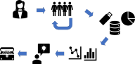

# Data platform: data warehouse

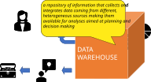

# Data platform: platform generations

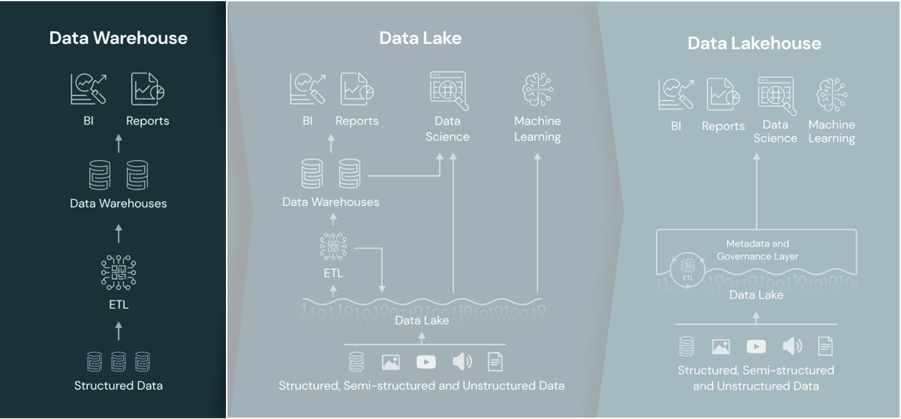

# Data platform: DWH definition

::::{.columns}
:::{.column width=50%}

> **Data Warehouse (DWH)** [@golfarelli2009data]
>
> "A collection of data that supports decision-making processes. It provides the following features: *subject-oriented*, *integrated* and *consistent*, *evolution over time and it is not volatile*."

:::
:::{.column width=50%}

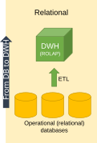

:::
::::

# Data platform: DWH definition

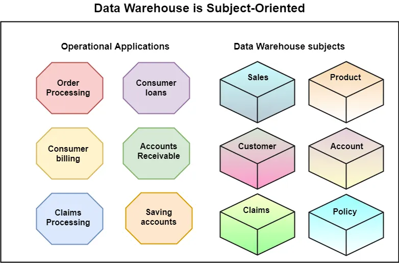

# Data platform: DWH definition

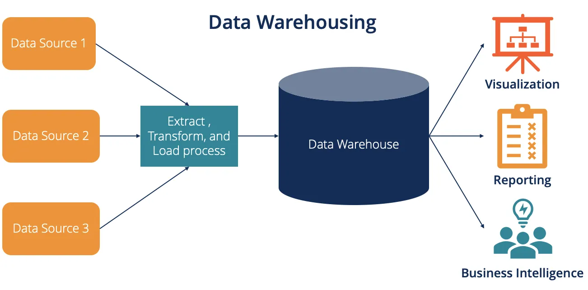

# Data platform: multidimensional analysis

:::{.fragment}
The **multidimensional model** is the key for representing and querying information in a DW

- (Business) *Facts* of interest are represented in *(hyper) cubes* where:
  - Each cell stores *numerical measures* that quantify the fact from different points of view;
  - Each axis is a *dimension* for analyzing measure values;
  - Each *dimension can be the root of a hierarchy* of attributes used to aggregated measure values
:::

:::{.fragment}
**Online analytical processing (OLAP)** to answer multi-dimensional analytical queries.

- Interactive sessions of analysis reading large amounts of data. 
:::

# Data platform: OLAP roll up

Querying the cube with OLAP operators: *roll up*

::::{.columns}
:::{.column width=50%}

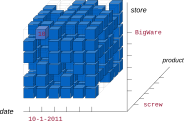

:::
:::{.column width=50%}

:::{.fragment}

:::
:::
::::

# Data platform: OLAP roll up

::::{.columns}
:::{.column width=50%}

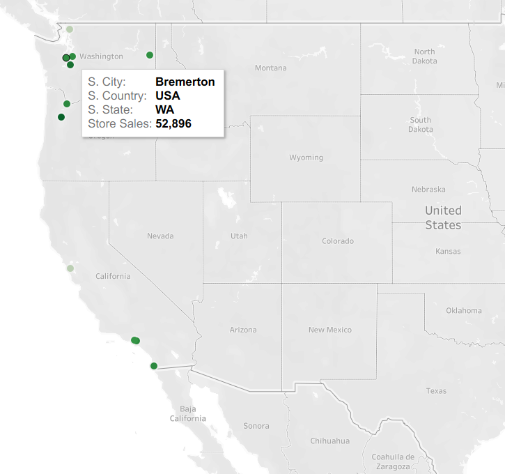

:::
:::{.column width=50%}

:::{.fragment}
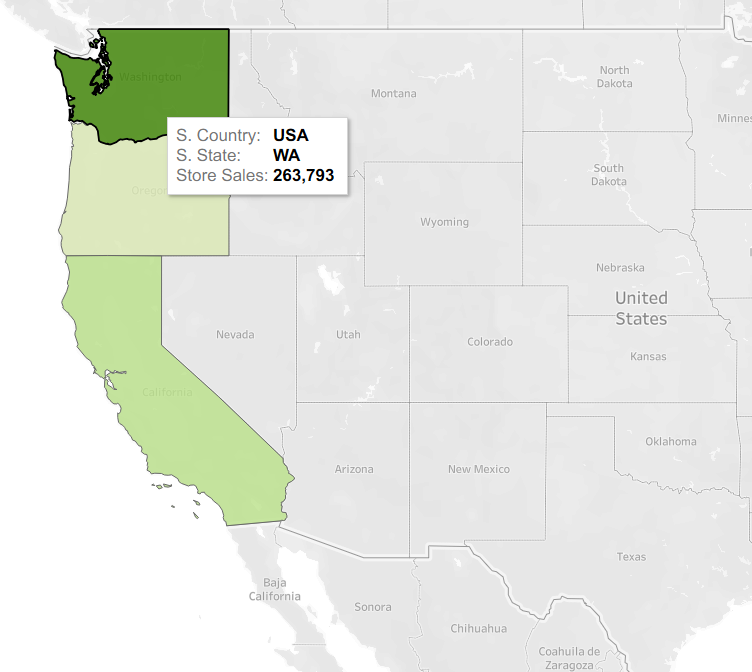
:::
:::
::::

# Data platform: OLAP drill down

Querying the cube with OLAP operators: *drill down*

::::{.columns}
:::{.column width=50%}

:::
:::{.column width=50%}
:::{.fragment}
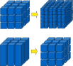
:::
:::
::::

# Data platform: OLAP drill down

Querying the cube with OLAP operators: *drill down*

::::{.columns}
:::{.column width=50%}

:::
:::{.column width=50%}
:::{.fragment}
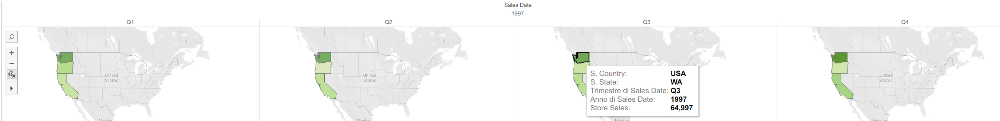
:::
:::
::::

# Data platform: dimensional fact model

The **Dimensional Fact Model** [@DBLP:journals/ijcis/GolfarelliMR98] is a graphical conceptual model for DWH design, devised to:

- create an environment in which user queries may be formulated intuitively
- make communication possible between designers and end users with the goal of formalizing requirement specifications
- build a stable platform for logical design (independently of the target logical model)
- provide clear and expressive design documentation

::::{.columns}
:::{.column width=50%}

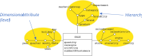

:::
:::{.column width=50%}

:::{.fragment}
![Corresponding Entity-Relationship representation [@DBLP:conf/hicss/GolfarelliMR98]](img/cube-dfm.png)
:::
:::
::::

# OLTP vs OLAP?

# Data platform: OLTP vs OLAP

| Characteristic | OLTP | OLAP |
|:-: |:-: |:-: |
| Type of workload | Constant transactions (reads/writes) | Periodic large writes, interactive large reads |
| Examples | Accounting database, online retail transactions | Reporting, decision support |
| Type | Operational data | Business data |
| Data retention | Short-term (2-6 months) | Long-term (2-5 years) |
| Storage | Gigabytes (GB) | Terabytes (TB) / Petabytes (PB) |
| Users | Many | Few |

# Data platform: platform generations

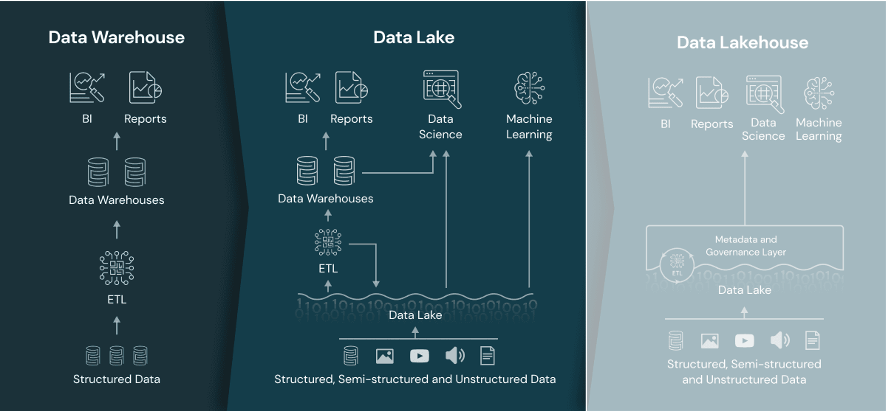

# Data platform: data lake definition

::::{.columns}
:::{.column width=50%}

> **Data lake** [@couto2019mapping]
>
> "A DL is a _central repository_ system for _storage, processing, and analysis of raw data_, in which the data is kept in its _original format and is processed to be queried only when needed_. It can _store a varied amount of formats_ in big data ecosystems, from unstructured, semi-structured, to structured data sources."

:::
:::{.column width=50%}

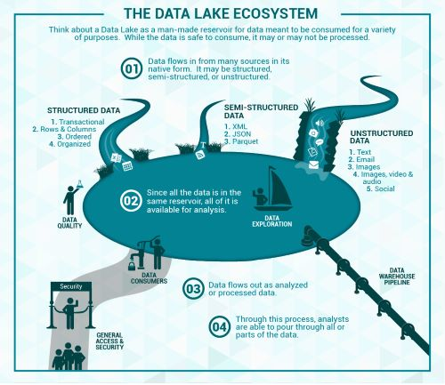

:::
::::

# Data platform: data lake architecture

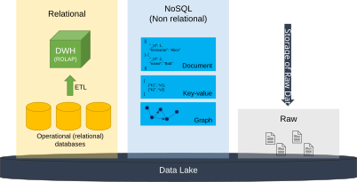

# Data platform: data lake limitations

The data lake started with the Apache Hadoop movement, using the Hadoop File System (HDFS) for cheap storage

- *Schema-on-read* architecture 
- Agility of storing any data at low cost
- Eludes the problems of quality and governance

Downsides of data lakes

- *Security*
  - All the data is stored and managed as files
  - No fine-grained access control on the contents of files, but only coarse-grained access governing who can access what files or directories
- *Quality*
  - Hard to prevent data corruption and manage schema changes
  - Challenging to ensure atomic operations when writing a group of files
  - No roll-back mechanism
- *Query performance*
  - Formats are not optimized for fast access

It is often said that the *lake* easily turns into a *swamp*

# DWH vs Data Lake?

# Data platform: DWH vs Data Lake

| | Data warehouse | Data lake |
|:-: |:-: |:-: |
| Data model | Relational | Non-relational and relational |
| Schema | Designed prior to implementation  (**schema-on-write**) | Written at the time of analysis   (**schema-on-read**) |
| Price/performance | Faster queries, higher cost storage | Slower queries, lower-cost storage |
| Data quality | Highly curated data, the central version of the truth | Any (raw) data |
| Users | Business analysts | Data scientists, developers, and business analysts |
| Analytics | Batch reporting, BI, and visualizations | Machine learning, predictive analytics, data discovery, and profiling. |

# Data platform: two-tier architecture

A two-tier data lake + DWH architecture is dominant in the industry

- HDFS replaced by cloud data lakes (e.g., S3, ADLS, GCS)
- Data lake directly accessible to a wide range of analytics engines
- A subset of data is "ETL-ed" to a DWH for important decision support and BI apps

While the data lake and DWH architecture is ostensibly cheap, a two-tier architecture is highly complex for users

- *Problems*?

# Data platform: two-tier limitations

(Some) main problems:

- Data is first ELTed into lakes, and then again ETLed into DWHs
  - *Reliability*. Keeping the data lake and DWH consistent is difficult and costly
  - *Data staleness*. The data in the DWH is stale compared to that of the data lake, with new data frequently taking days to load
- *Limited support for advanced analytics*.
  - Businesses want to ask predictive questions using their DWHs
  - Machine learning systems do not work well directly on top of DWHs
- *Process large datasets using complex non-SQL code*

# Data platform: towards lakehouses

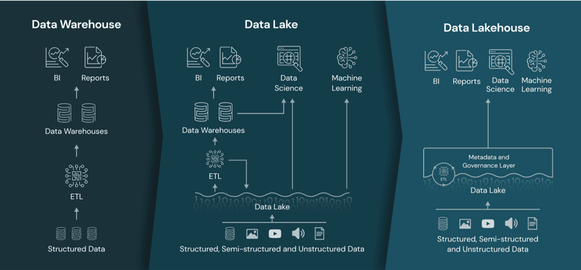

# Data lakehouse [@armbrust2021lakehouse]

::::{.columns}
:::{.column width=50%}

> **Data lakehouse**
>
> Data management architecture that combines the flexibility, cost-efficiency, and scale of data lakes with the data management and ACID transactions of DWHs, enabling business intelligence (BI) and machine learning (ML) on all data

Key technologies used to implement Data Lakehouses

- Databricks' Delta Tables
- Apache Hudi
- Apache Iceberg

:::
:::{.column width=50%}

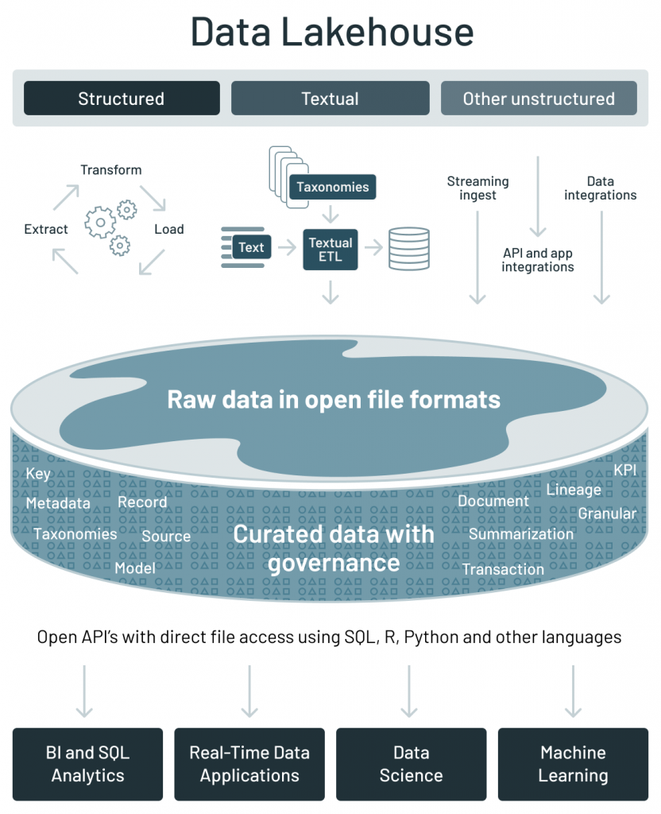

:::
::::

[https://databricks.com/blog/2021/05/19/evolution-to-the-data-lakehouse.html](https://databricks.com/blog/2021/05/19/evolution-to-the-data-lakehouse.html)

[https://www.databricks.com/glossary/data-lakehouse](https://www.databricks.com/glossary/data-lakehouse)

# Data lakehouse: main features

Main features:

- Store data in a low-cost object store using a standard file format such as Apache Parquet
- Implement a transactional metadata layer on top of the object store that defines which objects are part of a table version
- Implement management features within the metadata layer

Challenges:

- The metadata layer is insufficient to achieve good SQL performance
- DWHs use several techniques to get state-of-the-art performance
  - Storing hot data on fast devices such as SSDs, maintaining statistics, building efficient indexes, etc.
- In a Lakehouse it is not possible to change the format, but it is possible to implement other optimizations that leave the data files unchanged

# Data lakehouse: metadata challenges {visibility="hidden"}

**Challenges:**

- Most data lakes (e.g., cloud object stores) are simple key-value stores without cross-key consistency.  
- Multi-object updates aren't atomic, and there's no isolation between queries.  
  - Queries updating multiple objects can expose readers to partial updates as each object is written individually.  
- For large tables with millions of objects, metadata operations are costly.
  - The latency of cloud object stores can make data-skipping checks slower than the query itself.  

::::{.columns}
:::{.column width=50%}

**Delta Lake** uses a transaction log compacted into Apache Parquet for much faster metadata operations on large tabular datasets.  

- The log resides in the `_delta_log` subdirectory.  
- It contains:  
  - JSON objects with sequential IDs for log records (i.e., commits)
  - Periodic checkpoints summarizing the log up to that point  
:::
:::{.column width=50%}

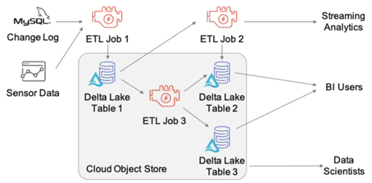

:::
::::

# Data lakehouse: comparison

|  | Data Warehouse | Data Lake | Data Lakehouse |
|:-:|:-:|:-:|:-:|
| Data format | Proprietary format | Open format | Open format |
| Types of data | Structured | \* | \* |
| Data access | SQL-only, no file access | File access | APIs for SQL, R, Python, etc. |
| Reliability | High quality, ACID transactions | Low quality, "data swamp" | High quality, ACID transactions |
| Governance & security | Fine-grained (row/column-level) | Weak governance; file-level security | Fine-grained (row/column-level) |
| Performance | High | Low | High |
| Scalability | Expensive at scale | Scales cheaply for any data type | Scales cheaply for any data type |
| Use case | BI | Machine learning | Unified for BI and ML |

# Data platform: data hub

*Data lakes (or lakehouses)* have increasingly taken the role of *data hubs*

- Eliminate up-front costs of ingestion and ETL since data are stored in the original format
- Once in DL, data are available for analysis by everyone in the organization

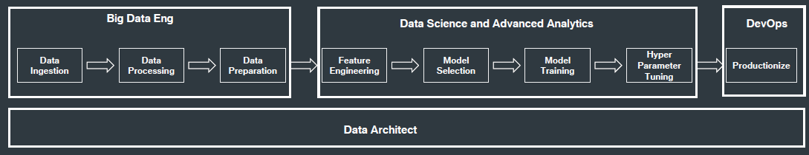

*Blurring* of the *architectural borderlines*: Drawing a sharp line between storage/computation/analysis is hard

- DL is often replaced by "data platform" or "data ecosystem"
- Encompass systems supporting data-intensive storage, computation, analysis

# Data platform: final definition

> **Data platform**
>
> A *unified* infrastructure that facilitates the ingestion, storage, management, and exploitation of large volumes of heterogeneous data. It provides a collection of *independent* and *well-integrated* services meeting *end-to-end* data needs.
>
> - *Unified*: is conceptually a data backbone
> - *Independent*: a service is not coupled with any other
> - *Well-integrated*: services have interfaces that enable easy and frictionless composition
> - *End-to-end*: services cover the entire data life cycle

Rationale: relieve users from the complexity of administration and provision

- Not only technological skills, but also privacy, access control, etc.
- Users should only focus on functional aspects

# Example of data platform: Hadoop-based

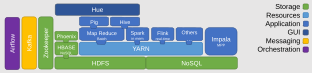

# On-premises manual provisioning

**Technical challenges**

- Installation: how do I set up a new machine?
- Networking: how do I cable dozens of machines?
- Management: how do I replace a broken disk?
- Upgrade: how do I extend the cluster with new services/machines?
- (energy and cooling, software licenses, insurance...)

**Technological challenges**

- How do we configure a distributed environment?
- How do we set up/integrate/control independent services?
- How do we orchestrate data flows?

**Business challenges**

- Can we afford to spend resources on tasks that are not mission-oriented?
- No free lunch, each choice has a cost/benefit
- How much time does it take to master a technology?
- How many people do I need?

# Data platform: related job positions

_Data engineer_

- Orchestrate the successful implementation of cloud technologies within the data infrastructure of their business
- Have a strong understanding of the impact of different database types and their implementation
- Responsible for purchasing decisions for cloud services and approval of data architectures

_Data scientist_

- Analyze and interpret complex digital data
- Work with new technologies (e.g., machine learning) to deepen the business's understanding and gain new insights

# Summing up

Storage should be flexible enough to support heterogeneous data models and raw data.

- From operational databases to DWHs **(why?)**
- From relational data models to NoSQL **(why?)**
- Data lake to (directly) ingest raw data

Storage, _per se_, is insufficient to get value from the data **(examples?)**

- We also need data processing and fruition
- Data lakes are blurring into data platforms

Data platforms support end-to-end data needs **(which ones?)**

- Building data platforms is hard **(why?)**
- Managing data platforms is hard; exploit metadata to ease this task
- Data lineage, compression, profiling, resolution, etc.

**Open question**: How do we deploy working data platforms?

# How do I know if I am prepared for the exam?

:::{.fragment}
Open a random slide, are you able to explain its content and connect it to the rest of the topics?
:::

# References