# Which functionalities for (automated) data governance can you think about?

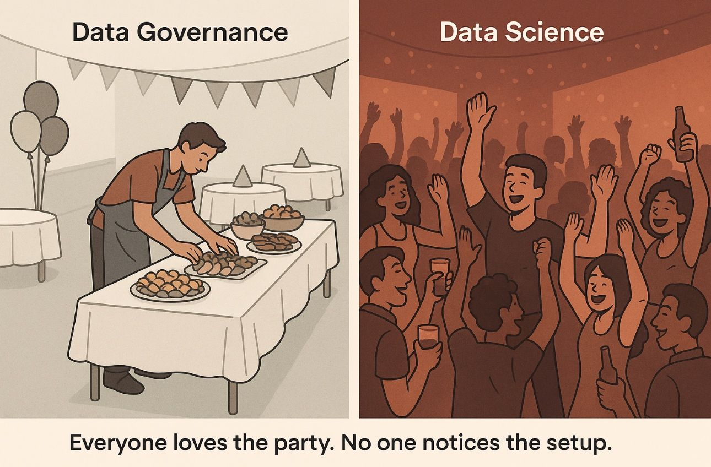

# Managing data platforms

Each governance capability answers a practical platform question.

- *Tracking data pipelines*: Data provenance
- *Tracking changes*: Data versioning
- *Understanding the data*: Data profiling
- *Integrating data sources*: Entity resolution
- ...

# Data governance

::::{.columns}
:::{.column width=60%}

> **Data governance**
>
> Techniques to ensure that data is secure, private, accurate, available, and usable

- It includes the actions people must take, the processes they must follow, and the technology that supports them throughout the data life cycle
- Every organization needs data governance since industries proceed on their digital-transformation journeys

A *data steward* is a role that ensures that data governance processes are followed and that guidelines are enforced, and recommends improvements to data governance processes. 

:::
:::{.column width=40%}

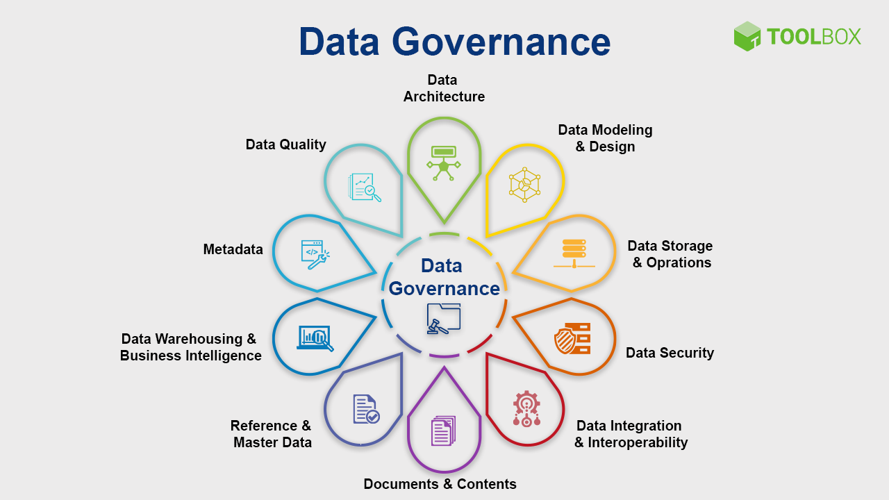

:::
::::

#  Case study: data governance {background-color="#121011"}



# End of the case study {background-color="#121011"}

# Data governance: data profiling

Can we understand the content, structure, and quality of a dataset before using it?

# Data profiling: analysis vs profiling

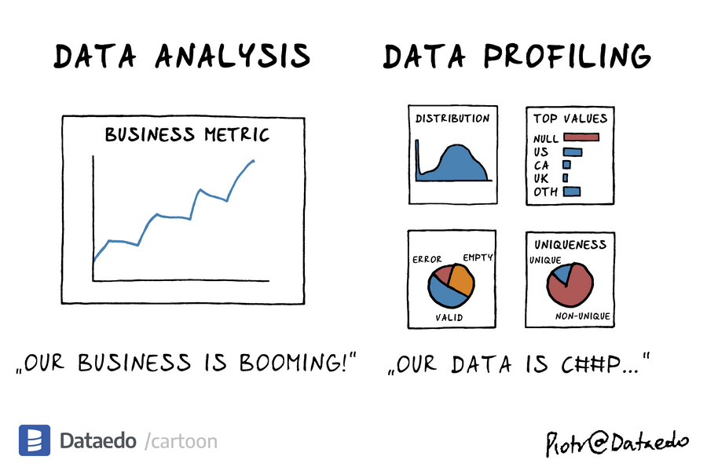

# Data profiling: definition

::::{.columns}
:::{.column width=60%}

Data profiling [@naumann2014data]

- A broad range of methods to efficiently analyze a given data set
- E.g., in a _relational_ scenario, _tables_ of a relational database are _scanned_ to derive _metadata_, such as _data types_, _completeness_ and _uniqueness_ of columns, _keys_ and  _foreign keys_, and occasionally _functional dependencies_ and _association rules_

:::
:::{.column width=40%}

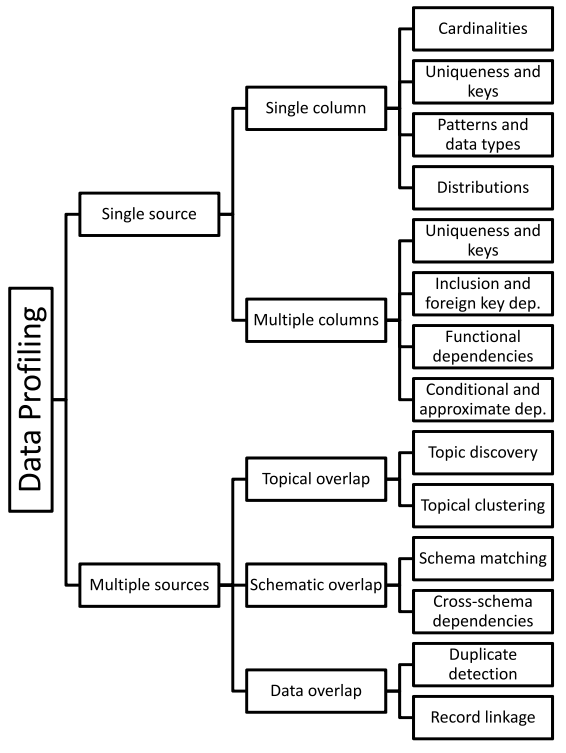

:::
::::

# Data profiling: single column (Iris dataset)

:::: {.columns}

::: {.column width=50%}

```
df.info()
```

> ```
> <class 'pandas.core.frame.DataFrame'>
> RangeIndex: 150 entries, 0 to 149
> Data columns (total 5 columns):
> #   Column             Non-Null Count  Dtype  
> ---  ------             --------------  -----  
> 0   sepal length (cm)  150 non-null    float64
> 1   sepal width (cm)   150 non-null    float64
> 2   petal length (cm)  150 non-null    float64
> 3   petal width (cm)   150 non-null    float64
> 4   species            150 non-null    int64  
> dtypes: float64(4), int64(1)
> memory usage: 6.0 KB
> ```

:::

::: {.column width=50%}

```
df.describe()
```

> |       |   sepal length (cm) |   sepal width (cm) |   petal length (cm) |   petal width (cm) |
> |:------|--------------------:|-------------------:|--------------------:|-------------------:|
> | count |          150        |         150        |           150       |         150        |
> | mean  |            5.80917  |           3.06167  |             3.72667 |           1.18333  |
> | std   |            0.823805 |           0.449123 |             1.75234 |           0.752289 |
> | min   |            4.3      |           2        |             1       |           0.1      |
> | 25%   |            5.1      |           2.8      |             1.5     |           0.3      |
> | 50%   |            5.75     |           3        |             4.25    |           1.3      |
> | 75%   |            6.4      |           3.4      |             5.1     |           1.8      |
> | max   |            7.7      |           4.4      |             6.7     |           2.5      |

:::
::::

How much metadata are we producing?

:::{.fragment}
- 8 statistics × 4 columns = 32 metadata values
- The dataset contains 150 rows
- Metadata-to-data ratio: $\frac{32}{150} ≈ 21.3\%$
:::


# Data profiling: computational cost

The results of data profiling are _computationally heavy_ to discover

- E.g., discovering keys/dependencies usually involves some sorting step for each considered column

... and we need to verify them _for groups of columns_ in a database

```
df.corr(method='pearson', numeric_only=True)
```

> |                   |   sepal length (cm) |   sepal width (cm) |   petal length (cm) |   petal width (cm) |
> |:------------------|--------------------:|-------------------:|--------------------:|-------------------:|
> | sepal length (cm) |            1        |          -0.106926 |            0.862175 |           0.80148  |
> | sepal width (cm)  |           -0.106926 |           1        |           -0.432089 |          -0.369509 |
> | petal length (cm) |            0.862175 |          -0.432089 |            1        |           0.962577 |
> | petal width (cm)  |            0.80148  |          -0.369509 |            0.962577 |           1        |

**Complexity**: given a table with four columns $\{w, x, y, z\}$, how many groups of columns?

# Data profiling: column groups

::::{.columns}
:::{.column width=50%}

Given a table with four columns $\{w, x, y, z\}$

<div style="display: flex; justify-content: center; align-items: center; height: 100%;">
| w | x | y | z |
|:-: |:-: |:-: |:-: |
| 1 | 1 | 2 | 2 |
| 1 | 2 | 1 | 4 |
</div>

- Cardinality of each column, consider $\binom{|C|}{1}=|C|$ columns $\{(w), (x), (y), (z)\}$
- Correlations between pairs of columns, consider $\binom{|C|}{2}$ groups $\{(w, x), (w, y), (w, z), (x, y), ...\}$

:::
:::{.column width=50%}

:::{.fragment}
Extracting the relationships among all possible groups of columns generalizes to $\sum_{n=1}^{|C|}\binom{|C|}{n}=2^{|C|}−1$ groups

- 3 columns → 7 groups, 5 columns → 31, 10 columns → 1023, ...


:::
:::
::::

# Data profiling {visibility="hidden"}

Use cases

- _Query optimization_
  - Performed by DBMS to support query optimization with statistics about tables and columns
  - Profiling results can be used to estimate the selectivity of operators and the cost of a query plan
- _Data cleansing_ (typical use case is profiling data)
  - Prepare a cleansing process by revealing errors (e.g., in formatting), missing values, or outliers
- _Data integration and analytics_

# Example of use case for data profiling: statistic query optimization

::::{.columns}
:::{.column width=30%}

> Table `R`
>
> | `a` | `b` |
> |-----|-----|
> | 10  | 20  |
> | 20  | 30  |
> | 30  | 40  |
>
> `min(R.a) = 10`
>
> `max(R.a) = 30`

No need to access `R.a`, `min(R.a) >= 10`

:::
:::{.column width=70%}

![[@bruno2002exploiting]](img/executionplan.png)

:::
::::

# Data governance: data provenance

Can we explain where data came from and which transformations produced it?

# Data provenance [@herschel2017survey]

> **Provenance** (also referred to as lineage, pedigree, parentage, genealogy)
> 
> - The description of the origins of data and the process by which it arrived at the database
> - Not only data products (e.g., tables, files), but also the processes that created them

# Data provenance: astronomers 

::::{.columns}
:::{.column width=60%}

Examples of use cases [@simmhan2005survey]

- Astronomy changed from being an individualistic to a _collective enterprise_
- Telescope time is devoted/allocated to systematic sky surveys, and analysis is performed using data from the archives
- A _federation_ of astronomical _data resources_ coupled with _computational resources_ needed to exploit the data scientifically
- Astronomers are _increasingly relying on data that they did not take themselves_
- Raw data bear _many instrumental signatures that must be removed_ in the process of generating data products [@mann2002some]

:::
:::{.column width=40%}

](img/slides14.jpg)

:::
::::

# Data provenance: PROV model

Provenance is a graph, for which we have a standard: [PROV-DM](https://www.w3.org/TR/2013/NOTE-prov-primer-20130430/) [@moreau2022provenance]

::::{.columns}
:::{.column width=60%}

_Entity_

- Physical/conceptual things

_Activity_

- Dynamic aspects of the world, such as actions
- How entities come into existence, often making use of previously existing entities

_Agent_

- A person, a piece of software
- Takes a role in an activity such that the agent can be assigned some degree of responsibility for the activity taking place

:::
:::{.column width=40%}

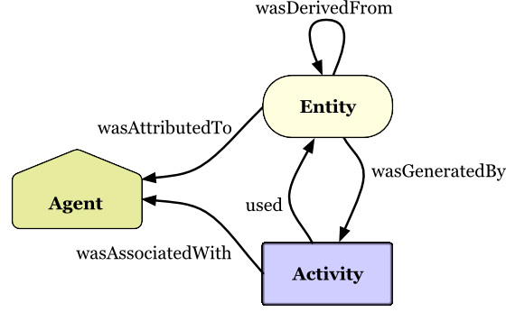

:::
::::

# Data provenance: graph analysis {visibility="hidden"}

::::{.columns}
:::{.column width=70%}
Measures of centrality

* **Betweenness centrality (A)**
  * Number of shortest paths between two nodes that pass from a certain node
* **Closeness centrality (B)**
  * Sum of distances to all other nodes.
* **Eigenvector centrality (C)**
  * The score of a node is influenced by score of adjacent nodes (Page rank)
* **Degree centrality (D)**
  * Number of adjacent nodes
:::
:::{.column width=30%}
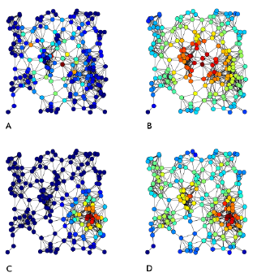
:::
::::

# Data provenance: characteristics

![Characteristics of data provenance [@simmhan2005survey]](img/slides15.png)

# Data provenance: granularity

Granularity [@simmhan2005survey]

- _Fine-grained_ (instance level): tracking data items (e.g., a tuple in a dataset) transformations
- _Coarse-grained_ (schema-level): tracking dataset transformations

# Data provenance: fine-grained vs coarse-grained

How would you document this table update?
 
> ::::{.columns}
> :::{.column width=50%}
> 
> Original data
> 
> | `product_id` | `sales_v1` |
> |:-------------|--------:|
> | "p1"         |      10 |
> | "p2"         |      20 |
> | "p3"         |      30 |
> | "p4"         |      10 |
> | "p5"         |      20 |
> | "p6"         |      30 |
> 
> :::
> :::{.column width=50%}
> 
> Update action: ```sales_v2 = sales_v1 + 1```
> 
> | `product_id` | `sales_v2` |
> |:-------------|--------:|
> | "p1"         |      11 |
> | "p2"         |      21 |
> | "p3"         |      31 |
> | "p4"         |      11 |
> | "p5"         |      21 |
> | "p6"         |      31 |
> 
> :::
> ::::

# Data provenance: fine-grained vs coarse-grained

::::{.columns}
:::{.column width=20%}

:::
:::{.column width=60%}

::::{.columns}
:::{.column width=100%}

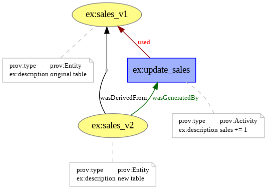

:::
:::{.column width=100%}

:::{.fragment}

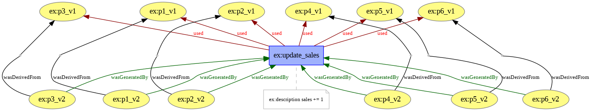

:::
:::
::::

:::
::::

# Data provenance: fine-grained vs coarse-grained

*Coarse-grained* provenance is appropriate to ensure a broad coverage of heterogeneous transformations involving several applications

*Fine-grained* provenance is typically used for single vertical applications

* It requires to collect huge amounts of detailed information to enable a very detailed tracing

Choosing a granularity is the *result of a trade-off between accuracy and computational effort*

* Storing only the name and the version of a clustering algorithm enables an approximate reproducibility of the results
* Storing all its parameters makes this functionality much more accurate

# Data provenance: query types

Queries [@ikeda2009data]

- _Where_ provenance: given some output, which inputs did the output come from?
- _How_ provenance: given some output, how were the inputs manipulated?
- _Why_ provenance: given some output, why was data generated?
  - E.g., in the form of a proof tree that locates source data items contributing to its creation


# Data provenance: use cases {visibility="hidden"}

Use cases for data provenance.

- Accountability and auditing
- Data quality
    - Monitoring of the quality (e.g., accuracy) of the objects produced
    - Notify when a transformation pipeline is not behaving as expected
- Debugging
    - Inferring the cause of pipeline failures is challenging
    - Store inputs of each operation with versions and environmental settings (RAM, CPUs, etc.)

# Data governance: data versioning

Can we reproduce an analysis by recovering the exact state of code, models, and data?

# Data versioning: definition

::::{.columns}
:::{.column width=50%}

Version control

- A class of systems responsible for managing changes to computer programs, documents, or data collections
- Changes are identified by a number/letter code, termed the revision/version number

However, data pipelines are not only about code but also about

- Model Version control
- Data Version Control
- Model Parameter Tracking
- Model Performance Comparison

:::
:::{.column width=50%}

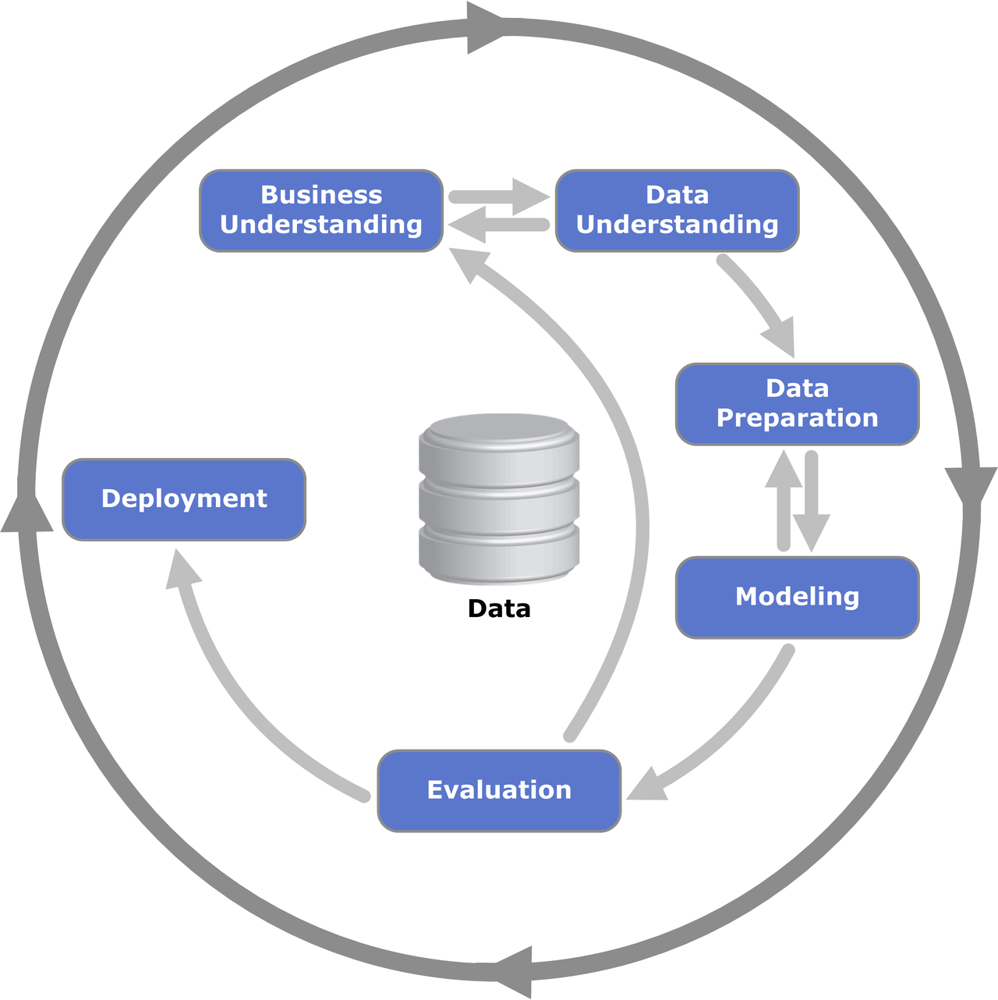

:::
::::

# Data versioning: CRUD operations

Support CRUD (Create, Read, Update, Delete) operations with versions.

For example, on [AWS (PUT, GET, DELETE)](https://docs.aws.amazon.com/AmazonS3/latest/userguide/versioning-workflows.html)

::::{.columns}
:::{.column width=40%}

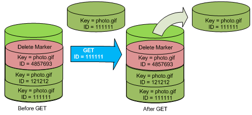

:::
:::{.column width=24%}

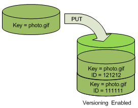

:::
:::{.column width=25%}

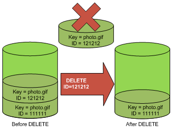

:::
::::

What about updating?

# Data governance: entity resolution {visibility="hidden"}

Can we recognize when different records refer to the same real-world entity?

# Entity resolution {visibility="hidden"}

Entity resolution [@papadakis2020blocking], also known as entity matching or linking

- Find records that refer to the same entity across different data sources

::::{.columns}
:::{.column width=50%}

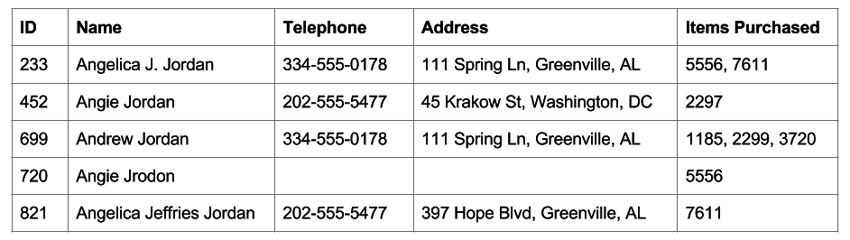

:::
:::{.column width=50%}


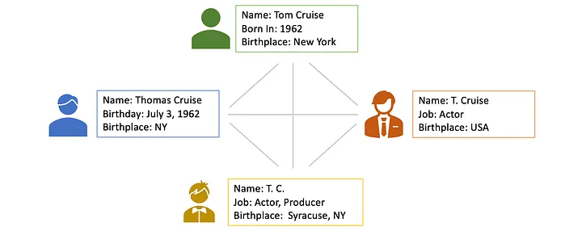

:::
::::

# Data governance: data catalog

Can users discover, understand, and request access to data assets without inspecting raw data first?

# Data catalog: definition

::::{.columns}
:::{.column width=60%}

A **data catalog** is an organized inventory of the company's data [@olesen2023enterprise]

- The data catalog provides an overview at a metadata level only
- No actual data values are exposed.
- Everyone sees the metadata they need without exposing confidential or sensitive data.

:::
:::{.column width=40%}

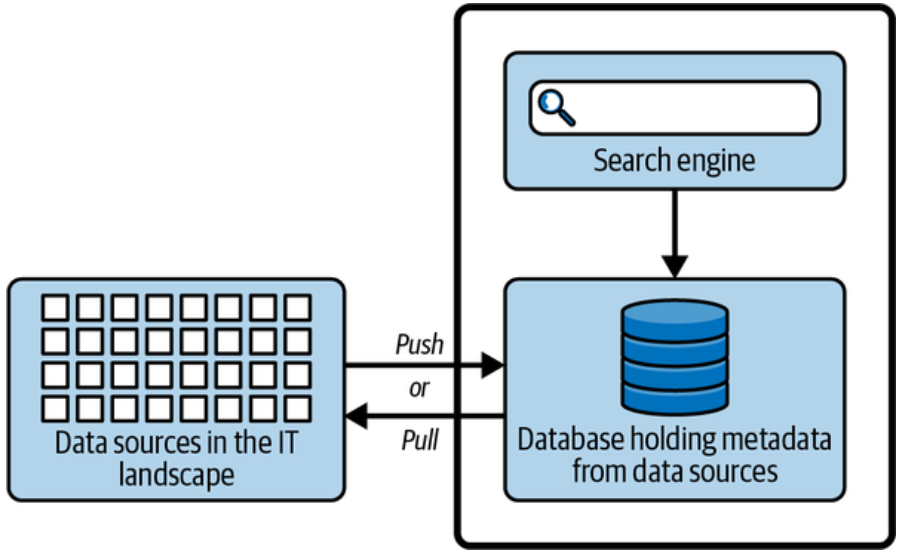

:::
::::

# Data catalog: domains {visibility="hidden"}

::::{.columns}
:::{.column width=60%}

Metadata is organized into **domains**.

- A domain is a group of entities sharing knowledge, goals, methods of operation, and communication

:::
:::{.column width=40%}

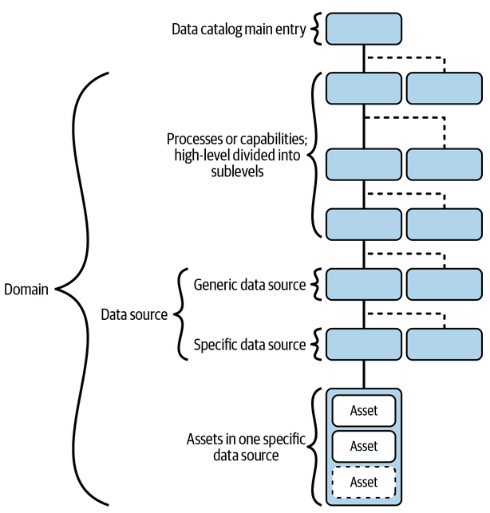

:::
::::

# Data catalog: processes vs capabilities {visibility="hidden"}

::::{.columns}

*Processes* describe how a company performs its tasks.

*Capabilities* describe what tasks a company performs.

- Neither processes nor capabilities reflect the business units of your company 1:1.

:::{.column width=50%}

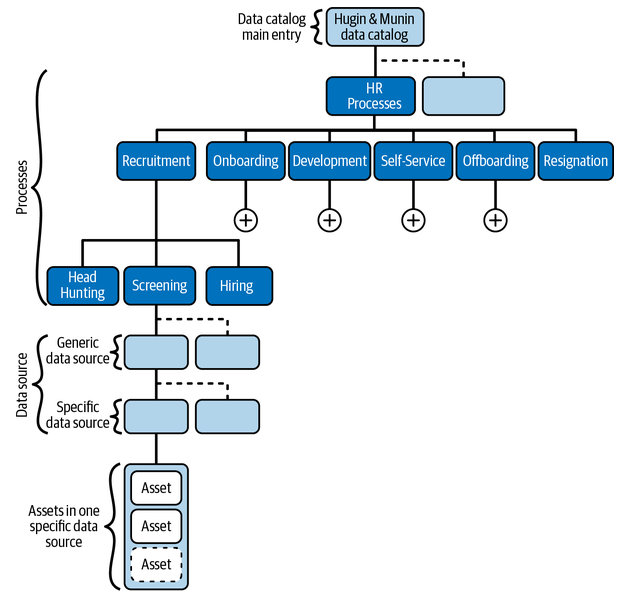

:::
:::{.column width=50%}

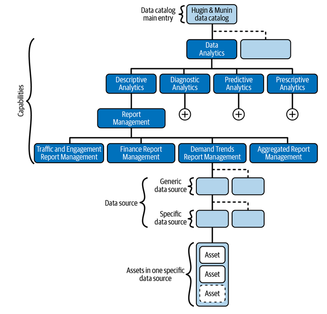

:::
::::

#  Case study: data governance {background-color="#121011"}

Check Colab

<a href="https://colab.research.google.com/github/w4bo/AA2627-unibo-bdcp/blob/main/slides/lab-01-Metadata.ipynb" target="_parent"></a>

#  Case study: data catalog {background-color="#121011"} {visibility="hidden"}

[Link to the DataHub catalog](http://localhost:9002/)

# End of the case study {background-color="#121011"}

# Data platform {visibility="hidden"}

**Is it a Lakehouse with another name?**

- A Lakehouse is a part of the data platform, a layer that enables querying multiple data sources (with SQL/Spark) transparently by using some metadata (JSON) log
- Still, you could get a data platform where such transparency is not mandatory or could be achieved by different techniques (e.g., multistore [@DBLP:journals/vldb/ForresiGGH21])

# Data platform {visibility="hidden"}

**Is it a new name for BI?**

No, in a data platform, you also need to manage (streams of) operational data and OLTP workloads.

# Designing data platforms

# Three layers for modern data platforms

| Layer | Main question | Main mechanism |
|---|---|---|
| **Data fabric** | How do we connect and govern distributed data assets? | Active metadata, integration, orchestration |
| **Data mesh** | Who owns data products, quality, and access? | Domains, data products, federated governance |
| **AI-powered platform** | How do humans and agents understand and use the platform? | Semantic layer, RAG, GraphRAG, LLM wiki |

Takeaway:

> Fabric connects the platform. Mesh assigns responsibility. AI makes the platform understandable.

# Data fabric: definition

**Data fabric** is a design concept "for data management [...] that seamlessly connects different clouds environments." ([2016](https://cloud.netapp.com/hubfs/Data-Fabric/Data%20Fabric%20WP%20April%202017.pdf))

Frictionless access and sharing of data in a distributed data environment

- Enables a *single and consistent data management framework*
- *Continuously identifies and connects data* from disparate applications to discover unique business-relevant relationships

It is a unified architecture with an integrated set of technologies and services.

- Designed to deliver integrated and enriched data at the right time, in the right method, and to the right data consumer
- Combines key data management technologies such as *data governance*, *integration*, *pipelining*, and *orchestration*

[Gartner (2021). Data fabric architecture](https://www.gartner.com/smarterwithgartner/data-fabric-architecture-is-key-to-modernizing-data-management-and-integration)

[K2View Whitepaper (2021). What is a Data Fabric? The Complete Guide](https://www.k2view.com/what-is-data-fabric/)

# Data fabric: example from Cloudera

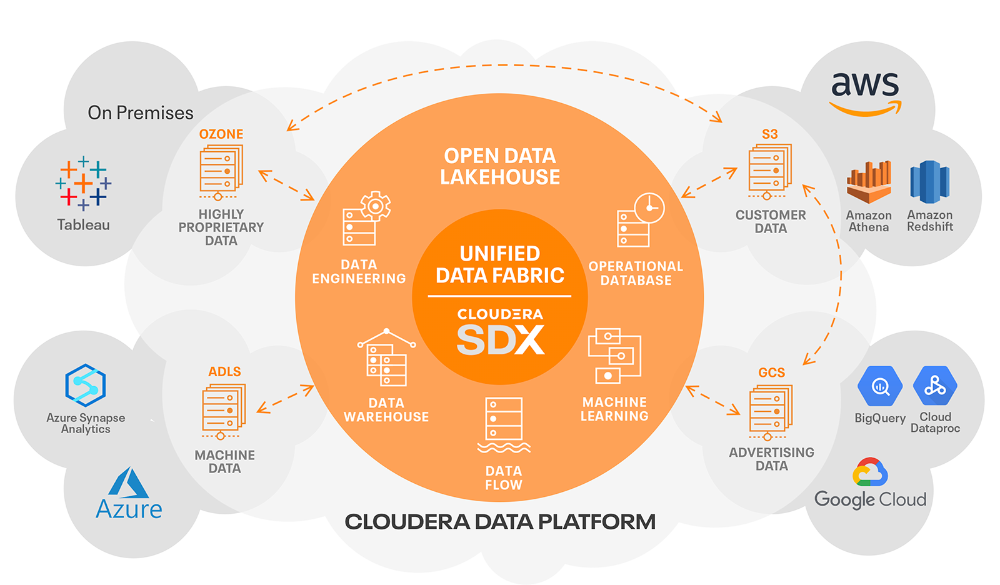

# Data fabric: design concept {visibility="hidden"}

**It is a design concept**

- It optimizes data management by automating repetitive tasks
- Gartner framed data fabric as a maturing vendor framework for automating data management tasks

::::{.columns}
:::{.column width=50%}

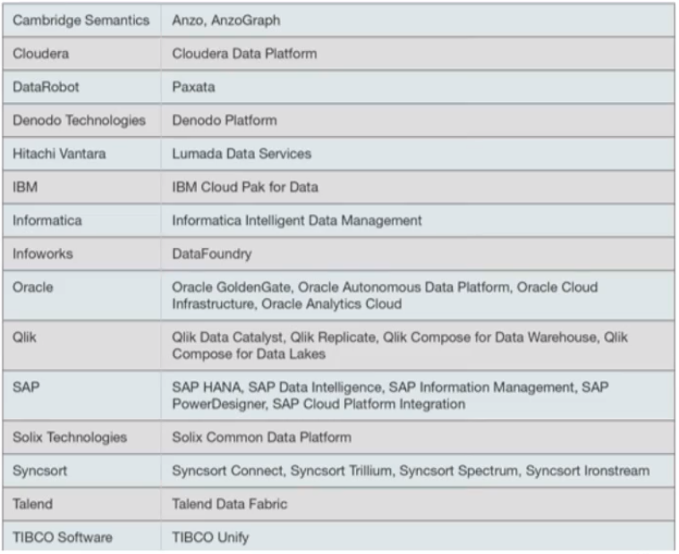

:::
:::{.column width=50%}

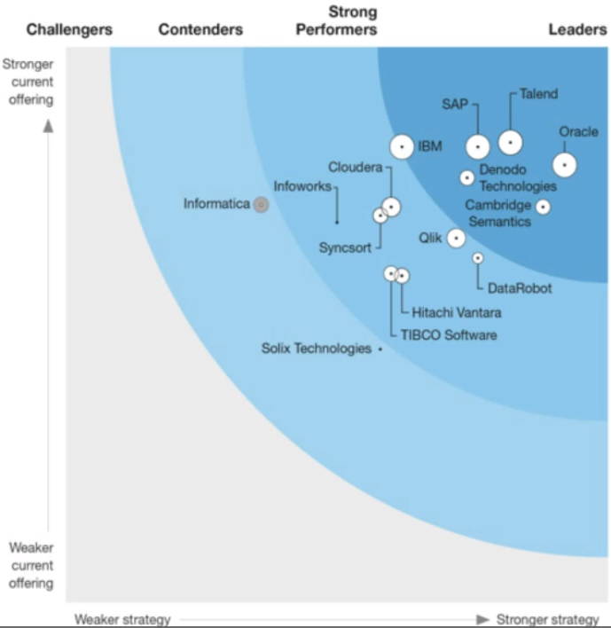

:::
::::

[Gartner (2021). Data fabric is key to modernizing data management](https://www.gartner.com/smarterwithgartner/data-fabric-architecture-is-key-to-modernizing-data-management-and-integration)

# Data fabric: capabilities

* *Catalog all data*: Cover business glossary, design-time, and runtime metadata.
* *Enable self-service capabilities*: Support data discovery, profiling, exploration, quality checks, and consumption.
* *Provide a knowledge graph*: Visualize links among data, people, processes, and systems for actionable insight.
* *Deliver automatic integration*: Help IT and business users with data integration, transformation, virtualization, and federation.
* *Manage unified lifecycle*: Maintain a consistent end-to-end Data Fabric lifecycle across platforms and teams.

# Data fabric: active metadata

::::{.columns}
:::{.column width=55%}

**Active metadata**: leverage open APIs to connect platform services using metadata.

*Active metadata is always on*

- Automatically and continually collect metadata from various sources.

*Active metadata is "intelligent"*:

- Constantly process metadata to connect the dots and create intelligence.
- E.g., auto-classify sensitive data, automatic suggestions to document data.

*Active metadata is action-oriented*

- Active metadata should drive actions such as curating recommendations

*Active metadata is open by default*

- Use APIs to hook into every piece of the data platform.

:::
:::{.column width=45%}

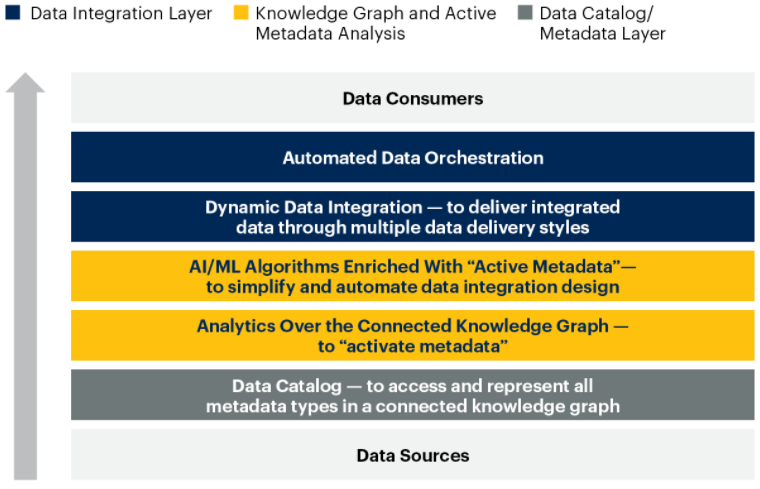

:::
::::

[Gartner (2021). Data fabric is key to modernizing data management](https://www.gartner.com/smarterwithgartner/data-fabric-architecture-is-key-to-modernizing-data-management-and-integration)

# Automation through orchestration: role {visibility="hidden"}

The orchestrator is the component in charge of controlling the execution of computation activities

  * Either through a regular scheduling of the activities
  * Or by triggering a process in response to a certain event

Several entities (either processes or human beings) can cover this role to activate some data processes

# Automation through orchestration: decisions {visibility="hidden"}

Dynamic/condition-based behavior

* Decide _what_ data process should be activated under different conditions
* Decide _how_ to tune the parameters in case of parametric data processes

Triggering

* Decide _when_ to trigger a certain data process

Scoping

* Assess the trustworthiness of objects to decide _if_ a certain data process should be activated or not

Resource estimation or prediction (based on previous executions and current settings)

* Decide the optimal amount of resources required to terminate successfully while leaving sufficient resources to the other concurrent process
* Negotiate the resources with the cluster's resource manager

# Automation through orchestration

![[@barika2019orchestrating]](img/phdslides_209.png)

# Automation through orchestration: resources {visibility="hidden"}

::::{.columns}
:::{.column width=60%}

![[@barika2019orchestrating]](img/phdslides_209.png)

:::
:::{.column width=40%}

R1 Compute/CPU resource provisioning

* Determine the right amount of resources
* Continuous management in a dynamic environment

R2 Storage

* Choose the right cloud storage resource, data location, and format (if the application is parametric)

R3 Data movement

* Dynamically transfer large datasets between compute and storage resources

R4 Synchronization and asynchronization

* Manage data flow dependencies across analytics tasks

:::
::::

# Automation through orchestration: execution guarantees {visibility="hidden"}

::::{.columns}
:::{.column width=60%}

![[@barika2019orchestrating]](img/phdslides_209.png)

:::
:::{.column width=40%}

R5 Analytic Task Scheduling and Execution

- Coordinate workflows across diverse big data models
- Track and capture data provenance

R6 Service Level Agreement

- Meet user-defined QoS, such as strict deadlines

R7 Security

- Support anonymous computation, verify outcomes in multi-party settings, etc.

R8 Monitoring and Failure-Tolerance

- Ensure streamlined execution
- Handle or predict failures as they occur
:::
::::

# Data mesh: principles

Distributed data architecture under centralized governance for interoperability, enabled by a shared and harmonized self-serve data infrastructure

- *Domain-oriented decentralized data ownership*
  - Decentralization and distribution of responsibility to people who are closest to the data, to support continuous change and scalability
  - Each domain exposes its own operational/analytical APIs
- **Data as a product** (_quantum_)
  - Products must be discoverable, addressable, trustworthy, self-describing, and secure
- *Self-serve data infrastructure as a platform*
  - High-level abstraction of infrastructure to provision and manage the lifecycle of data products
- *Federated computational governance*
  - A governance model that embraces decentralization and domain self-sovereignty, interoperability through global standardization, a dynamic topology, and automated execution of decisions by the platform

[Zhamak Dehghani (2019). Data monolith to mesh](https://martinfowler.com/articles/data-monolith-to-mesh.html)

[Zhamak Dehghani (2020). Data mesh principles](https://martinfowler.com/articles/data-mesh-principles.html)

[Zhamak Dehghani (2021). Introduction to Data Mesh](https://www.youtube.com/watch?v=_bmYXWCxF_Q)

# Data mesh: domains and data products

::::{.columns}
:::{.column width=50%}

Data Mesh organizes data around **business domain owners** and transforms relevant data assets (data sources) to **data products** that can be consumed by distributed business users from various business domains or functions.

- Data products are created, governed, and used in an **autonomous, decentralized**, and self-service manner
- **Self-service capabilities**, which we have already referenced as a Data Fabric capability, enable business organizations to entertain a data marketplace with shopping-for-data characteristics

:::
:::{.column width=50%}

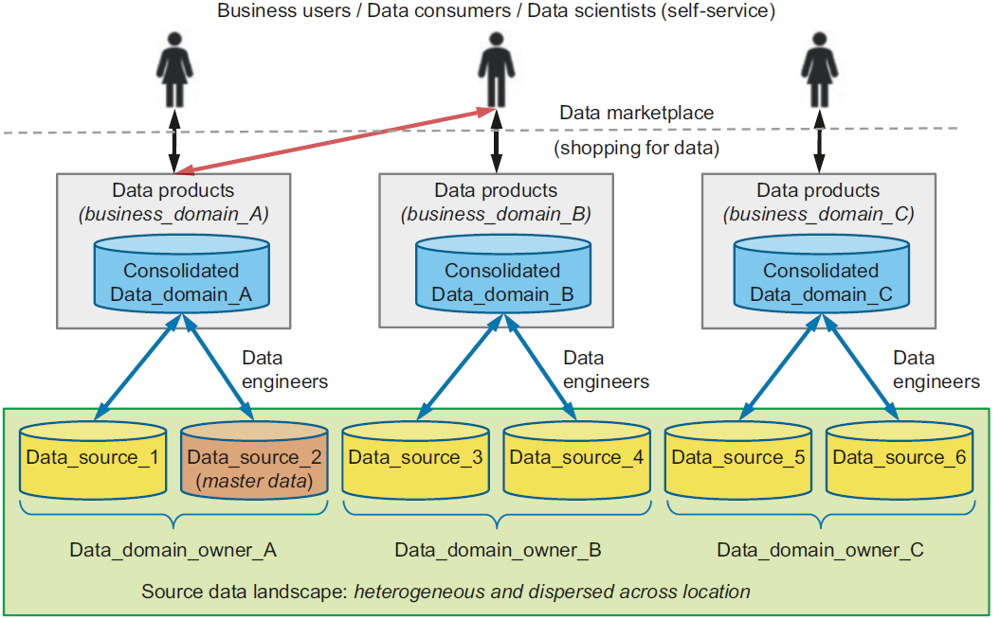

:::
::::

# What makes data a product?

A **data product** is raw data transformed into a business context

- Data products are registered in the **knowledge catalog** through specifications (XML, JSON, etc.).
- Data products need to be searchable and discoverable by potential data product consumers and business users.
  - *Cataloged*: All data products need to be registered in the knowledge catalog.
  - *Data product description*: The data product needs to be well-described.
  - *Access methods*: for example, REST APIs, SQL, NoSQL, etc., and where to find the data asset.
  - *Policies and rules*: who is allowed to consume the data product for what purpose.
  - *SLAs*: agreements regarding the data product availability, performance characteristics, functions, and cost of data product usage.
- Data products themselves are not stored in the knowledge catalog

#  Case study: data mesh {background-color="#121011"}

Check the seminars from HERA.

# End of the case study {background-color="#121011"}

# Data mesh vs data fabric: emphasis

Both provide an architectural framework to access data across multiple technologies and platforms.

**Data fabric**

- Attempts to centralize and coordinate data management
- Tackles the complexity of data and metadata in a smart way that works well together
- Focus on the architectural, technical capabilities, and intelligent analysis to produce active metadata supporting a smarter, AI-infused system to orchestrate various data integration styles

**Data mesh**

- Emphasis on decentralization and data domain autonomy
- Focuses on organizational change; it is more about people and process
- Data are primarily organized around domain owners who create business-focused data products, which can be aggregated and consumed across distributed consumers

Alex Woodie, 2021 [https://www.datanami.com/2021/10/25/data-mesh-vs-data-fabric-understanding-the-differences/](https://www.datanami.com/2021/10/25/data-mesh-vs-data-fabric-understanding-the-differences/)

Dave Wells, 2021 [https://www.eckerson.com/articles/data-architecture-complex-vs-complicated](https://www.eckerson.com/articles/data-architecture-complex-vs-complicated)

# Data mesh vs data fabric: visual comparison

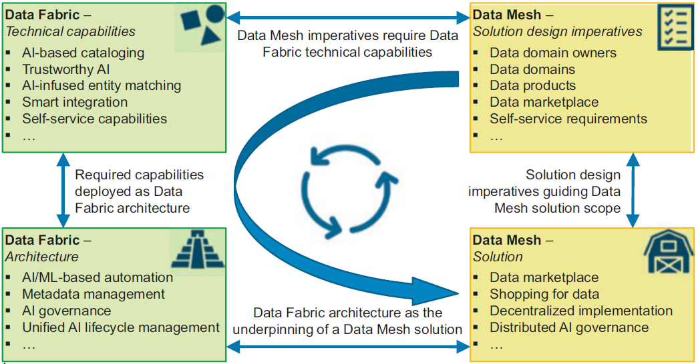

# Data mesh: hype-cycle trend

::::{.columns}
:::{.column width=50%}

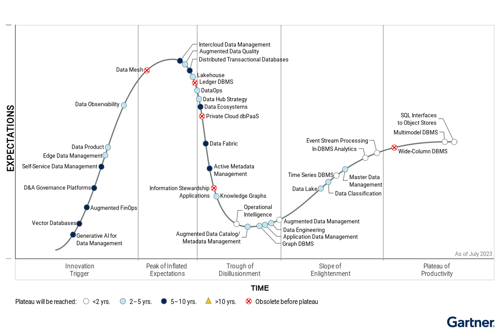

:::
:::{.column width=50%}

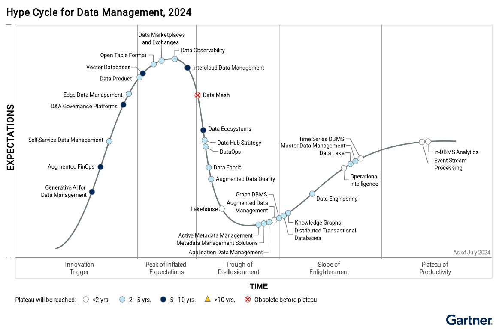

:::
::::

As new technologies and solutions mature to support a centralized approach to data access, distributed approaches like Data Mesh are expected to fall increasingly out of favor in enterprise IT.

# Data mesh: hype-cycle positioning

::::{.columns}
:::{.column width=50%}

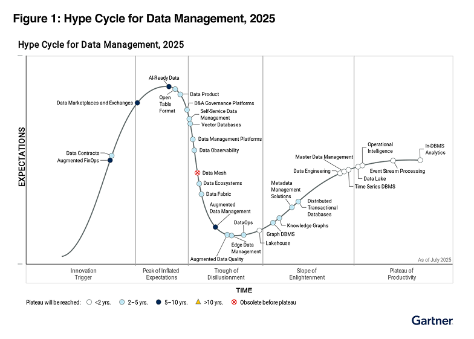

:::
:::{.column width=50%}

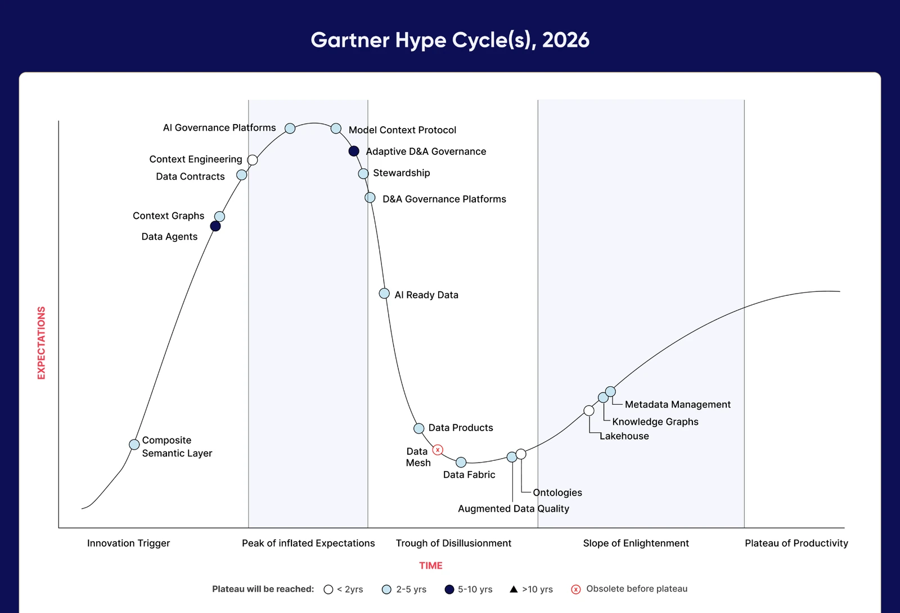

:::
::::

# What changes with Agents, LLMs, and generative AI?

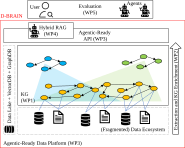

The main shift:

- A data platform does not only store and process data
- It also explains data assets, relationships, and usage constraints
- Metadata becomes context for both humans and AI agents


# Semantic layer

A **semantic layer** maps technical assets to business concepts.

- Tables become business entities
- Columns become metrics, dimensions, policies, and definitions
- Queries can use business language instead of physical schemas

Close to **ontology-based data access**, where users query a conceptual layer while mappings connect it to source data [@bienvenu2018ontology].

Example:

- User asks: "monthly active customers by region"
- Semantic layer defines: customer, active, month, region, allowed filters
- Engine generates SQL against DWH/lakehouse tables

# RAG over platform knowledge

**Retrieval-Augmented Generation (RAG)** retrieves external evidence before the LLM generates an answer [@lewis2020retrieval].

In a data platform, the retrievable corpus can include:

- catalog descriptions, data-product documentation, access policies and data-quality checks
- lineage graphs and pipeline logs
- notebooks, dashboards, tickets, and incident reports

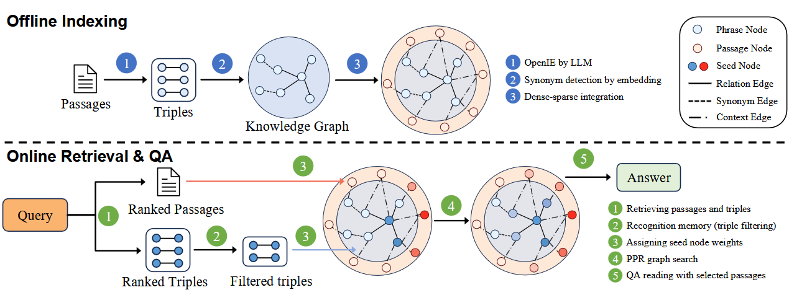

# GraphRAG for connected metadata

Plain RAG retrieves similar chunks.

**GraphRAG** builds a graph of entities and relationships, then retrieves from that graph for local and global questions [@hogan2021knowledge; @edge2025graphrag].

Example question:

> Which data products would be affected if we changed the customer identifier in the CRM ingestion pipeline?

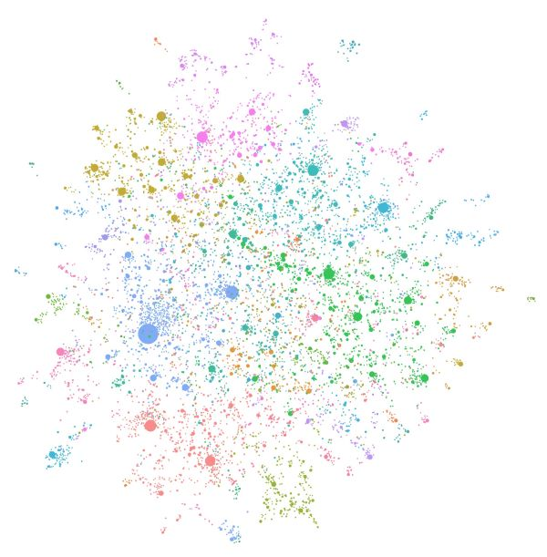

# LLM wiki for data products

An **LLM wiki** is a curated, human-readable layer generated from governed platform metadata.

Useful rule:

> Every generated page must cite catalog, lineage, or documentation sources.

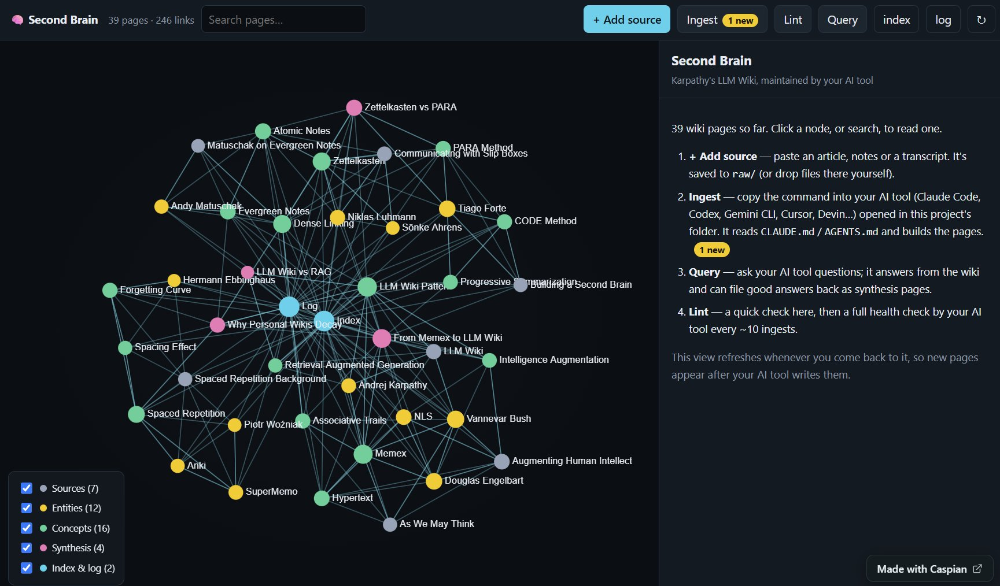

#



# Data agents

A **data agent** is a governed conversational layer over a data platform.

It combines an LLM with platform tools:

- semantic models, catalogs, schemas, and policies
- SQL, DAX, KQL, search, or code execution tools
- user permissions and governance checks
- readable answers with tables, charts, queries, or citations

The term is broad: recent work distinguishes simple query assistants from more autonomous agents for data management and analysis [@sui2026dataagents].

Examples:

- Microsoft Fabric Data Agent
- Databricks Genie Agents
- Snowflake Cortex Agents

# AI-powered data platforms: risks

The AI layer must inherit platform governance.

- **Grounding**: answers must point to catalog, lineage, and source documents
- **Freshness**: generated pages must expire or refresh when metadata changes
- **Access control**: retrieval must respect user permissions
- **Evaluation**: test answers on real platform questions, not generic prompts
- **Human review**: generated documentation should be reviewed for critical data products

Takeaway:

> AI makes metadata more usable, but it also makes metadata governance more important.

# Wooclap (examples of exam questions) {visibility="hidden"}

<iframe allowfullscreen frameborder="0" height="100%" mozallowfullscreen src="https://app.wooclap.com/LKDKIY/questionnaires/670e89be981e282b0b69ee7c" style="min-height: 550px; min-width: 300px" width="100%"></iframe>

# Further reading: architecture patterns {visibility="hidden"}

::::{.columns}
:::{.column width=33%}

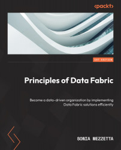

:::
:::{.column width=33%}

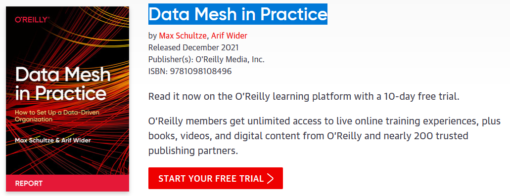

:::
:::{.column width=33%}

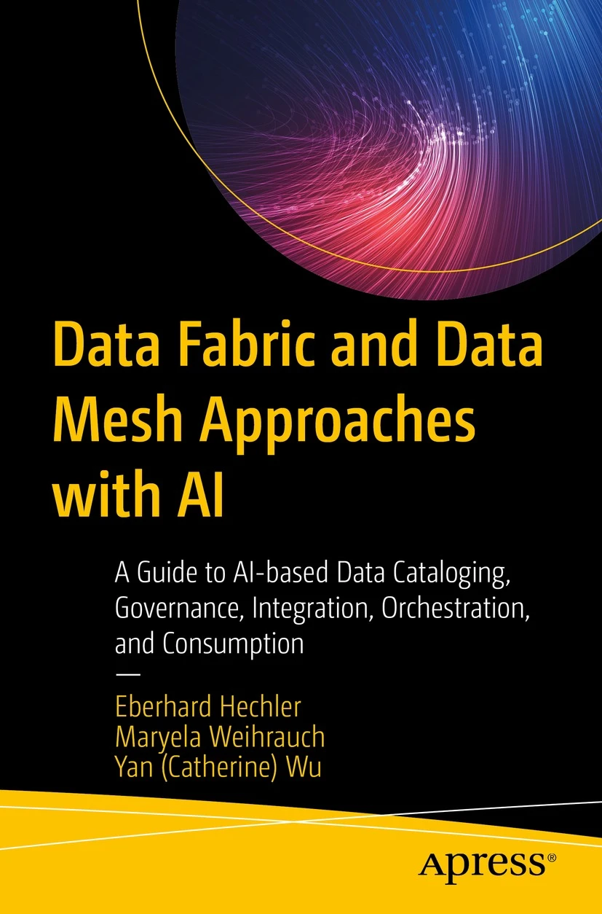

:::
::::

# From DevOps... {visibility="hidden"}

**DevOps** combines development and operations to increase the efficiency, speed, and security of software development and delivery compared to traditional processes.

DevOps practices enable software development (dev) and operations (ops) teams to accelerate delivery through automation, collaboration, fast feedback, and iterative improvement.

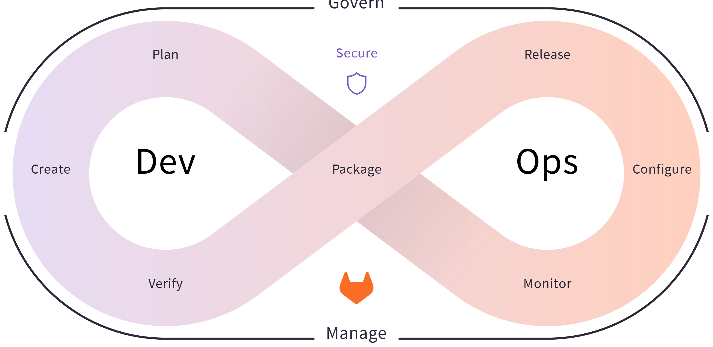

[https://about.gitlab.com/topics/devops/](https://about.gitlab.com/topics/devops/)

# ... to DataOps {visibility="hidden"}

::::{.columns}
:::{.column width=60%}

**DataOps** refers to a general process aimed at shortening the end-to-end data analytics life-cycle time by introducing automation in the data collection, validation, and verification process

![Evolution of DataOps [@munappy2020ad]](img/slides30.png)

:::
:::{.column width=40%}

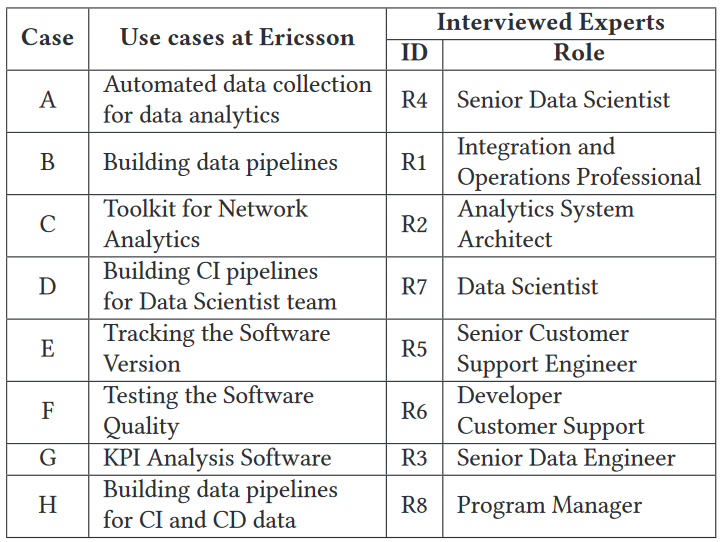

:::
::::

# DataOps {visibility="hidden"}

::::{.columns}
:::{.column width=60%}

From DevOps to DataOps

- "A collaborative data management practice focused on improving the _communication, integration and automation of data flows between data managers and data consumers across an organization_"
- Data analytics improved in terms of velocity, quality, predictability, and scale of software engineering and deployment

Some key rules

- Establish progress and performance measurements at every stage
- Automate as many stages of the data flow as possible
- Establish governance discipline (_governance-as-code_)
- Design process for growth and extensibility

:::
:::{.column width=40%}

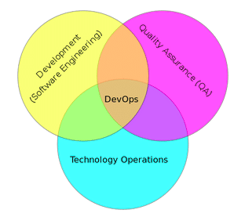

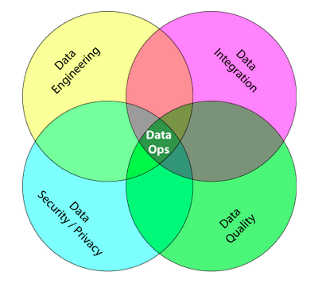

:::
::::

Gartner, 2020 [https://www.gartner.com/smarterwithgartner/how-dataops-amplifies-data-and-analytics-business-value](https://www.gartner.com/smarterwithgartner/how-dataops-amplifies-data-and-analytics-business-value)

Andy Palmer, 2015 [https://www.tamr.com/blog/from-devops-to-dataops-by-andy-palmer/](https://www.tamr.com/blog/from-devops-to-dataops-by-andy-palmer/)

William Vorhies, 2017 [https://www.datasciencecentral.com/profiles/blogs/dataops-it-s-a-secret](https://www.datasciencecentral.com/profiles/blogs/dataops-it-s-a-secret)

# "Example" of architecture

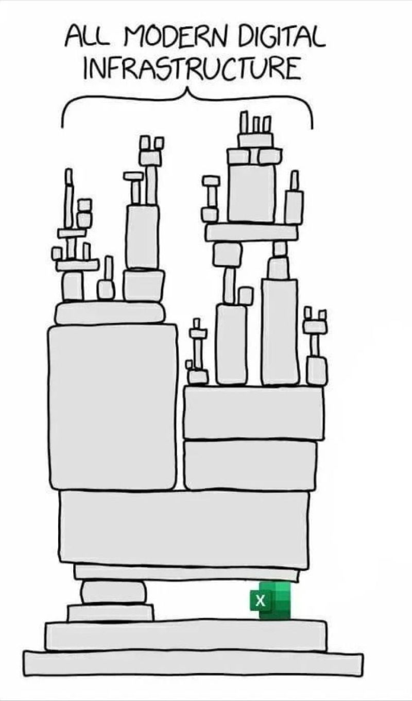

(*) "Ormai sta xkcd è una base troppo usata" A. Tappi

# "Example" of modern architecture

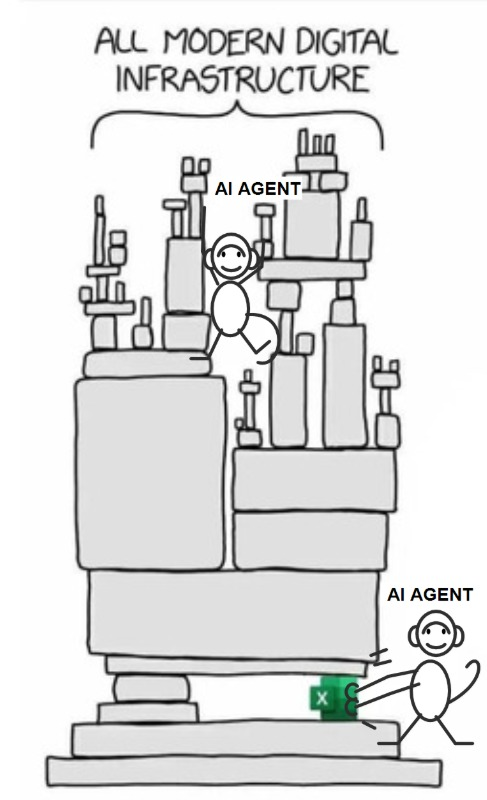

(*) "Per un totale di 4 crediti" N. Narducci

# Summing up

Storage should be flexible enough to support heterogeneous data models and raw data.

- From operational databases to DWHs **(why?)**
- From relational data models to NoSQL **(why?)**
- Data lake to (directly) ingest raw data

Storage,  _per se_, is insufficient to get value from the data **(examples?)**

- We also need data processing and fruition
- Data lakes are blurring into data platforms

Data platforms support end-to-end data needs **(which ones?)**

- Building data platforms is hard **(why?)**
- Managing data platforms is hard; exploit metadata to ease this task
- Data lineage, compression, profiling, resolution, etc.

**Open question**: How do we deploy working data platforms?

# How do I know if I am prepared for the exam?

:::{.fragment}
Open a random slide, are you able to explain its content and connect it to the rest of the topics?
:::

# References

